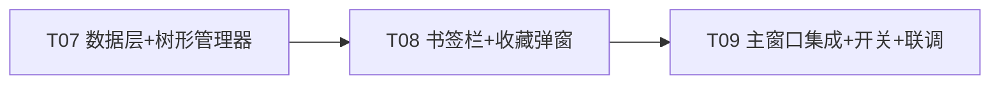
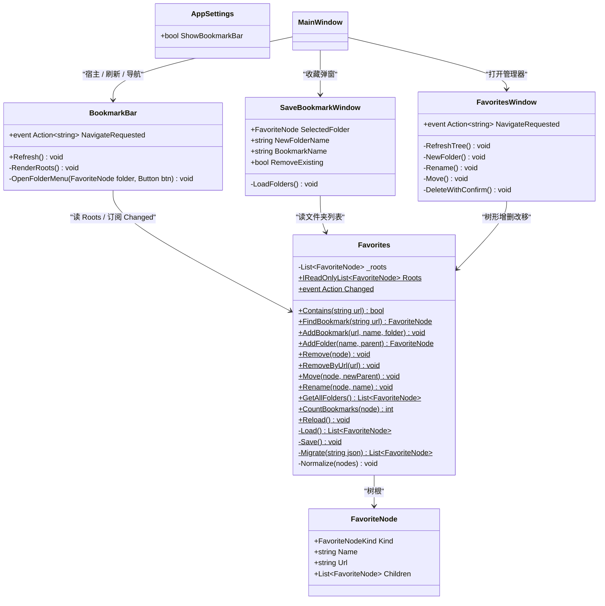
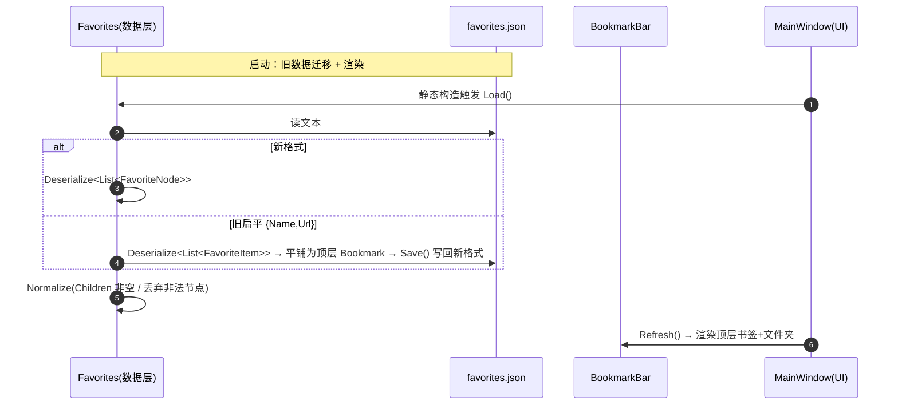
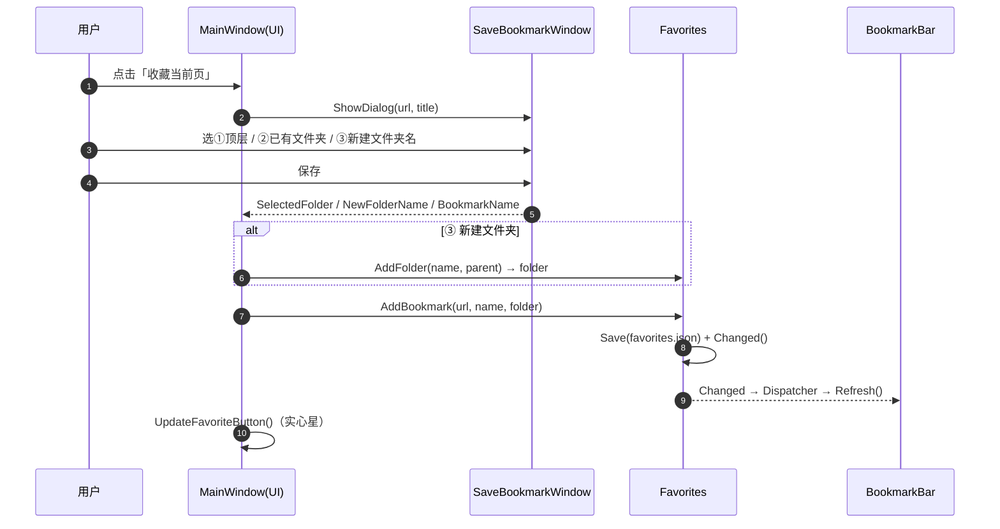
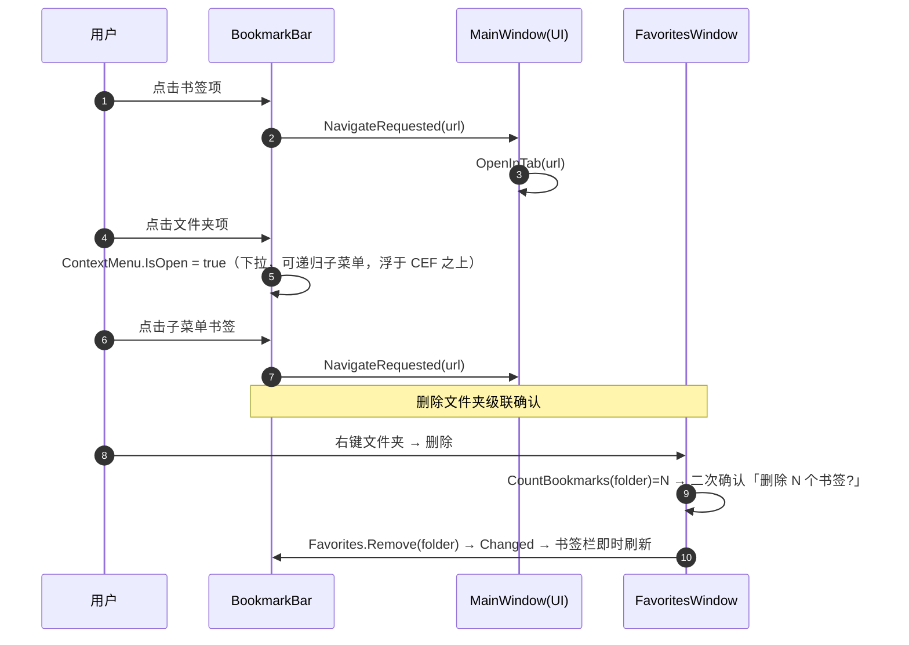

# 「书签栏（带文件夹层级）」增量设计文档（YeyouPlusPlus）

> 版本：v1.0（增量设计稿）
> 作者：software-architect（高见远）
> 需求依据：书签栏增量 PRD + 主理人已拍板 10 项决策
> 范围：仅设计，不写代码。**接续已完成的 T01–T06**，不动其已实现逻辑，仅做必要衔接点改造。
> 技术基线：C# net462（x64，WPF + WinForms）、CefSharp.WinForms 84.4.10、Newtonsoft.Json 13.0.3、零新增 native 依赖。

---

## 0. 结论速览

| 决策点 | 结论 |
|--------|------|
| 数据模型 | 单类 `FavoriteNode` + `Kind` 判别（Bookmark/Folder），`favorites.json` 升级为树；**旧扁平数据首次加载即迁移为顶层书签，幂等** |
| 书签栏 UI | 独立 `UserControl BookmarkBar`（横向 `ScrollViewer` + 按钮），文件夹下拉用 WPF `ContextMenu`（独立置顶 HWND，天然越过 CEF AirSpace，与现有 ZoomPopup 同理） |
| 收藏弹窗 | 新 `SaveBookmarkWindow`（模态），三级选择：顶层 / 选已有文件夹 / 新建文件夹 |
| FavoritesWindow | `ListBox` → `TreeView` 树形管理器（DataTemplateSelector 区分书签/文件夹），完整增删改移 + 级联删除确认 |
| 同步 | 单一数据源 `Favorites` + `Changed` 事件，书签栏与 FavoritesWindow 均订阅即时刷新 |
| 任务 | T07 数据层+管理器 → T08 书签栏+收藏弹窗 → T09 主窗口集成，共 3 个增量任务 |

---

## 1. 树形数据模型

### 1.1 类结构（单类 + Kind 判别）

采用**单一类 `FavoriteNode` + `Kind` 枚举**承载「Bookmark / Folder」两种节点语义，而非两个子类。理由：
- 与 `favorites.json` 的 JSON 往返零多态成本——不需要 `TypeNameHandling`（有反序列化安全顾虑）也不用手写 `JsonConverter`；
- 旧扁平 `{Name,Url}` 数据天然可解析为 `Kind=Bookmark`（枚举默认值 0），**迁移几乎零代码**；
- 概念上等价于 PRD 的 `Bookmark{Name,Url}` / `Folder{Name,Children[]}`，只是用 `Kind` 字段区分。

```csharp
public enum FavoriteNodeKind
{
    Bookmark = 0,   // 旧数据无 Kind 字段 → 默认落到此值，天然迁移
    Folder   = 1
}

public class FavoriteNode
{
    [JsonConverter(typeof(StringEnumConverter))]
    public FavoriteNodeKind Kind { get; set; }   // Bookmark | Folder
    public string Name { get; set; }
    public string Url { get; set; }              // 仅 Bookmark 使用
    public List<FavoriteNode> Children { get; set; } // 仅 Folder 使用（Load 后归一化为非 null）
}
```

> 说明：`Kind` 用 `StringEnumConverter` 序列化为可读的 `"Bookmark"` / `"Folder"`；反序列化时旧数据缺失该字段 → 枚举默认 `Bookmark(0)`，即旧扁平条目自动成为顶层书签。

### 1.2 favorites.json 新结构示例

```json
[
  { "Kind": "Bookmark", "Name": "4399小游戏", "Url": "https://www.4399.com" },
  {
    "Kind": "Folder", "Name": "页游",
    "Children": [
      { "Kind": "Bookmark", "Name": "奥奇传说", "Url": "https://aq.4399.com" },
      {
        "Kind": "Folder", "Name": "动作类",
        "Children": [
          { "Kind": "Bookmark", "Name": "拳皇Wing", "Url": "https://www.4399.com/flash/1234.htm" }
        ]
      }
    ]
  }
]
```

### 1.3 旧数据迁移算法（幂等）

`Favorites.Load()` 内执行：

```
1. 读文本（不存在 → 空列表）。
2. 尝试 Deserialize<List<FavoriteNode>>(text)  —— 新格式。
   成功 → 进入第 4 步归一化。
3. 失败（旧格式/损坏）→ Deserialize<List<FavoriteItem>>(text)  —— 旧扁平 {Name,Url}：
   nodes = legacy.Select(f => new FavoriteNode { Kind = Bookmark, Name = f.Name, Url = f.Url })
   Save(nodes)   // 立即写回新格式，保证下次启动直接命中新格式（幂等）
4. Normalize(nodes)：
   - 每个 Folder 的 Children 为 null 时置为 new List<FavoriteNode>()
   - 丢弃 Name 为空的节点、Kind 为 Bookmark 但 Url 为空的节点
5. 返回 nodes
```

要点：迁移**平铺到顶层、不建文件夹**（符合决策 8）；一次写回后即幂等；损坏文件回退空列表（沿用现有容错惯例）。

### 1.4 Favorites 新 API（替换旧扁平 API）

```csharp
public static class Favorites
{
    public static IReadOnlyList<FavoriteNode> Roots { get; }        // 顶层节点
    public static event Action Changed;                             // 任意增删改移后触发（单一数据源同步）

    public static bool Contains(string url);                        // 递归查找 Bookmark
    public static FavoriteNode FindBookmark(string url);            // 递归按 URL 查找
    public static void AddBookmark(string url, string name, FavoriteNode folder); // folder=null 表示顶层；同 URL 去重
    public static FavoriteNode AddFolder(string name, FavoriteNode parent);       // parent=null 表示顶层
    public static void Remove(FavoriteNode node);                   // 删除（Folder 级联删除其全部后代）
    public static void RemoveByUrl(string url);                     // 兼容旧星标语义：递归删第一个匹配 Bookmark
    public static void Move(FavoriteNode node, FavoriteNode newParent);           // 右键移动 / 弹窗移动
    public static void Rename(FavoriteNode node, string newName);
    public static List<FavoriteNode> GetAllFolders();               // 深度优先扁平化所有 Folder（收藏弹窗选择器用）
    public static int CountBookmarks(FavoriteNode folder);          // 级联统计书签数（删除确认提示用）
    public static void Reload();
}
```

- 所有写操作内部调用 `Save()` 并 `Changed?.Invoke()`（在 UI 线程约定：写操作都由 UI 线程发起，与现有 Favorites 用法一致）。
- `Contains` / `RemoveByUrl` 保持签名语义，`MainWindow.UpdateFavoriteButton` 无需改动即可继续工作。

---

## 2. 书签栏 UI 控件选型

### 2.1 承载位置（关键：不破坏既有 Grid 行）

在内容区 `Grid Grid.Row="1"` 内部改为「两行嵌套」，书签栏作为内容区顶部通栏，**不动顶层 Grid 的三行结构**（TabBar / 内容区 / 状态栏）与 `PhoneBoxPanel` 的既有定位：

```xml
<Grid Grid.Row="1">
  <Grid.RowDefinitions>
    <RowDefinition Height="Auto"/>   <!-- 书签栏 -->
    <RowDefinition Height="*"/>      <!-- 原三视图（HomePanel/BrowserView/SettingsPanel 继续互相叠放） -->
  </Grid.RowDefinitions>
  <local:BookmarkBar x:Name="BookmarkBar" Grid.Row="0" Visibility="Collapsed"/>
  <Grid Grid.Row="1">
    <!-- 现有 HomePanel / BrowserView / SettingsPanel 原样搬入此 Grid -->
  </Grid>
</Grid>
```

- `ShowView("home"/"browser")` 时 `BookmarkBar.Visibility = (显示开关) ? Visible : Collapsed`；`settings`/`phonebox` 时 Collapsed。
- 这样书签栏「主页顶部 + 浏览器标签页顶部」都成立，且与左侧边栏同属窗口级 chrome（全宽通栏）。

### 2.2 控件实现

**容器**：横向 `ScrollViewer`（`HorizontalScrollBarVisibility=Auto`、`VerticalScrollBarVisibility=Disabled`）+ 内部 `StackPanel Orientation=Horizontal`，由 `BookmarkBar.Refresh()` 程序化重建（复用 `MainWindow.RenderQuickLinks` 的既有代码风格）。

**书签项**：`Button`，内容 = `StackPanel`（默认图标 `TextBlock` + 标题 `TextBlock`，`TextTrimming` 省略号）。点击 → `NavigateRequested(url)`（新标签打开，走 `OpenInTab`）。右键 `ContextMenu`：打开 / 重命名 / 移动到文件夹… / 删除。

**文件夹项**：`Button`，内容 = `StackPanel`（文件夹图标 `\uE8B7` + 名称）。**点击展开（非悬停）**：`Click` 中 `contextMenu.PlacementTarget = btn; contextMenu.IsOpen = true;`。

**文件夹下拉（核心选型）**：用 WPF `ContextMenu`，其菜单项用 `MenuItem` + `HierarchicalDataTemplate`（`ItemsSource={Binding Children}`）递归绑定，天然支持多级嵌套子菜单（满足 ≤3 层，数据层不硬限制）：

```xml
<HierarchicalDataTemplate DataType="{x:Type local:FavoriteNode}" ItemsSource="{Binding Children}">
    <!-- Kind==Bookmark：点击打开；Kind==Folder：自动生成子菜单 -->
</HierarchicalDataTemplate>
```

- **AirSpace 关系**：`ContextMenu` 底层是 WPF `Popup`（独立的置顶原生窗口），**可以浮在 CEF HwndHost 之上**——与本项目已投入使用的 `ZoomPopup`（浮在浏览器区之上）完全同理，无需任何额外 HwndHost 桥接。书签栏本身在独立 Grid 行内、不与 `BrowserContainer` 重叠，无遮挡问题。
- 空状态：`Roots` 为空时显示占位 `TextBlock`「收藏的网页会显示在这里」。

**刷新与同步**：`BookmarkBar` 订阅 `Favorites.Changed` → `Dispatcher.InvokeAsync(Refresh)`；`NavigateRequested` 事件由 MainWindow 订阅并 `OpenInTab(url)`。

---

## 3. 收藏弹窗交互设计（二级收藏弹窗）

新 `SaveBookmarkWindow`（`Owner=MainWindow`，模态 `ShowDialog`）：

**输入**：构造传入 `(string url, string title)`。

**界面分区**：
1. 顶部：书签名称 `TextBox`（预填页面 `Title`，可编辑）；URL 只读 `TextBlock`。
2. 「收藏位置」三级选择（`RadioButton` 三选一）：
   - **① 收藏到书签栏顶层**（默认选中）；
   - **② 选择已有文件夹**：`ComboBox` 列出 `Favorites.GetAllFolders()`（显示缩进层级，如「页游 ▸ 动作类」）；
   - **③ 新建文件夹后收藏**：`TextBox` 输入新文件夹名（+ 可选「创建位置」下拉，默认顶层）。
3. 底部按钮：**保存** / **取消**（若当前 URL 已收藏，额外显示「已收藏」提示 + **移除收藏** 按钮，见待明确事项）。

**返回值**：`DialogResult==true` 时暴露：
- `SelectedFolder FavoriteNode`（`null` = 顶层）
- `NewFolderName string`（③ 时非空）
- `BookmarkName string`
- `RemoveExisting bool`（可选）

**MainWindow.FavoriteButton_Click 改造**：
```
url = CurrentHost.Address（about:blank 拦截同现状）
var dlg = new SaveBookmarkWindow(url, CurrentHost.Title)
if (dlg.ShowDialog() == true):
    if (dlg.RemoveExisting) Favorites.RemoveByUrl(url)
    else:
        folder = dlg.SelectedFolder
        if (!string.IsNullOrEmpty(dlg.NewFolderName))
            folder = Favorites.AddFolder(dlg.NewFolderName, dlg.SelectedFolder /* 创建位置 */)
        Favorites.AddBookmark(url, dlg.BookmarkName, folder)
    UpdateFavoriteButton()
```

不再沿用「点星标即收藏/再点取消收藏」的 toggle 行为——星标按钮仍按 `Contains` 显示实心/空心，但点击一律弹收藏弹窗。

---

## 4. FavoritesWindow 升级方案（树形管理器）

| 部位 | 现状 | 升级后 |
|------|------|--------|
| 列表 | `ListBox`（DisplayMemberPath=Name） | `TreeView`，`ItemTemplateSelector` 按 `Kind` 选书签/文件夹模板 |
| 书签模板 | 无 | `StackPanel`：默认图标 + Name（ToolTip=Url） |
| 文件夹模板 | 无 | `StackPanel`：文件夹图标 + Name，`HierarchicalDataTemplate ItemsSource=Children` |
| 打开 | 双击 → NavigateRequested | 双击书签 → NavigateRequested；双击文件夹 → 展开/折叠 |
| 工具栏 | 删除选中 / 关闭 | **新建文件夹 / 重命名 / 移动到… / 删除 / 关闭** |
| 右键菜单 | 无 | 节点右键：打开 / 重命名 / 移动到文件夹… / 删除 |

**级联删除确认**：删除文件夹时二次确认并提示数量——`Favorites.CountBookmarks(folder)` 得 N，弹「删除文件夹及其中的 N 个书签？此操作不可撤销。」确认后 `Favorites.Remove(folder)`。

**即时同步**：FavoritesWindow 在 `Loaded` 订阅、`Closed` 退订 `Favorites.Changed`，收到事件即 `RefreshTree()`；反之 FavoritesWindow 内的修改也走 `Favorites` 写操作 → 触发 `Changed` → 书签栏即时刷新。

**树绑定**：`TreeView.ItemsSource = Favorites.Roots`；由于单类 + `Kind` 判别，用 `DataTemplateSelector` 区分文件夹/书签模板（约 20 行），避免 `TypeNameHandling` 多态 JSON。

---

## 5. 文件列表（增量）

### 新增

| 相对路径 | 职责 |
|----------|------|
| `cs/src/BookmarkBar.xaml` | 书签栏 UserControl：横向条 + 文件夹下拉模板 + 空状态 |
| `cs/src/BookmarkBar.xaml.cs` | 渲染顶层节点、文件夹点击展开 ContextMenu、右键菜单、NavigateRequested 事件、订阅 Changed |
| `cs/src/SaveBookmarkWindow.xaml` | 二级收藏弹窗：名称/URL + 三级收藏位置选择 |
| `cs/src/SaveBookmarkWindow.xaml.cs` | 弹窗逻辑（加载文件夹、返回选择结果） |

### 修改

| 相对路径 | 修改点 |
|----------|--------|
| `cs/src/Favorites.cs` | 扁平 `FavoriteItem` → 树形 `FavoriteNode`（Kind/Url/Children）；`Load` 迁移 + 归一化；新 API + `Changed` 事件 |
| `cs/src/FavoritesWindow.xaml` | `ListBox` → `TreeView` + 文件夹/书签模板 + 工具栏按钮 |
| `cs/src/FavoritesWindow.xaml.cs` | 树绑定、右键菜单、新建/重命名/移动/级联删除确认、订阅/退订 Changed |
| `cs/src/AppSettings.cs` | 新增 `bool ShowBookmarkBar`（默认 true） |
| `cs/src/MainWindow.xaml` | 内容区改两行嵌套 + 挂 `BookmarkBar`；设置页加「显示书签栏」CheckBox |
| `cs/src/MainWindow.xaml.cs` | `FavoriteButton_Click` 改弹收藏弹窗；书签栏刷新/导航订阅、`ShowView` 可见性；`RefreshSettingsView` 读/存显示开关；`Favorites.Changed` 订阅联动 |

---

## 6. 任务列表（接续 T01–T06，编号从 T07 起）

### T07 收藏数据层升级 + 收藏夹树形管理器（P0）
- **内容**：`Favorites.cs` 树形化（模型 + 迁移 + 新 API + `Changed` 事件）；`FavoritesWindow` 升级为 TreeView 树形管理器（新建/重命名/移动/级联删除确认）；`AppSettings` 加 `ShowBookmarkBar`。
- **源文件**：`Favorites.cs`、`FavoritesWindow.xaml`、`FavoritesWindow.xaml.cs`、`AppSettings.cs`
- **依赖**：无（T01–T06 已完成）
- **验收**：旧 `favorites.json` 首次启动自动迁移为顶层书签且二次启动不变；FavoritesWindow 可完整增删改移；删除文件夹二次确认并提示数量。

### T08 书签栏控件 + 二级收藏弹窗（P0）
- **内容**：`BookmarkBar`（横向条 + 文件夹下拉 + 右键 + 空状态 + NavigateRequested + 订阅 Changed）；`SaveBookmarkWindow`（三级收藏位置选择）。
- **源文件**：`BookmarkBar.xaml`、`BookmarkBar.xaml.cs`、`SaveBookmarkWindow.xaml`、`SaveBookmarkWindow.xaml.cs`
- **依赖**：T07（依赖树形 API）

### T09 主窗口集成 + 设置开关 + 联调（P0）
- **内容**：`MainWindow.xaml` 内容区两行嵌套挂载书签栏 + 设置「显示书签栏」开关；`MainWindow.xaml.cs` 改 `FavoriteButton_Click`、书签栏刷新/导航订阅、`ShowView` 可见性、`RefreshSettingsView`、`Favorites.Changed` 联动；整体联调（含 AirSpace 验证：文件夹下拉浮于 CEF 之上）。
- **源文件**：`MainWindow.xaml`、`MainWindow.xaml.cs`、`FavoritesWindow.xaml.cs`（如需打开/关闭时刷新衔接）
- **依赖**：T08（以及 T07）

### 任务依赖图



---

## 7. 待明确事项

1. **已收藏时星标按钮行为**：PRD 说点击收藏弹二级弹窗；那「取消收藏」入口放哪？建议：弹窗内对已收藏项显示「移除收藏」按钮 + 书签栏右键「删除」+ FavoritesWindow 删除。需确认。
2. **「最近使用文件夹」为 P1、搜索为 P2**：P0 不实现，确认本次范围不含。
3. **默认图标样式**：书签默认用星标 `\uE734` 还是地球 `\uE774`（favicon 明确 P2）。默认建议地球 `\uE774`（与现有快捷入口占位一致）。
4. **水平溢出策略**：P0 用横向 `ScrollViewer`（可滚），还是 Chrome 式「>>」折叠按钮。建议 P0 用 ScrollViewer 简单实现。
5. **文件夹下拉层级过深（>3 层）**：ContextMenu 子菜单多层展开的宽度/滚动体验，P0 接受原生子菜单行为。
6. **收藏弹窗「新建文件夹」是否支持指定父文件夹**：决策只提「新建文件夹后收藏进去」，建议 P0 默认新建到顶层，可留 P1 支持选父级。

---

## 附 A：类图



## 附 B：关键时序






