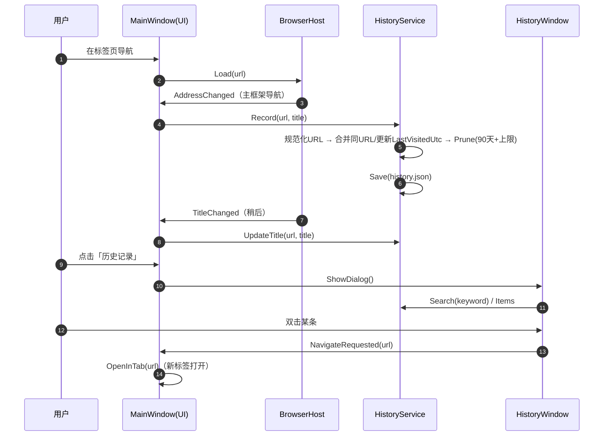
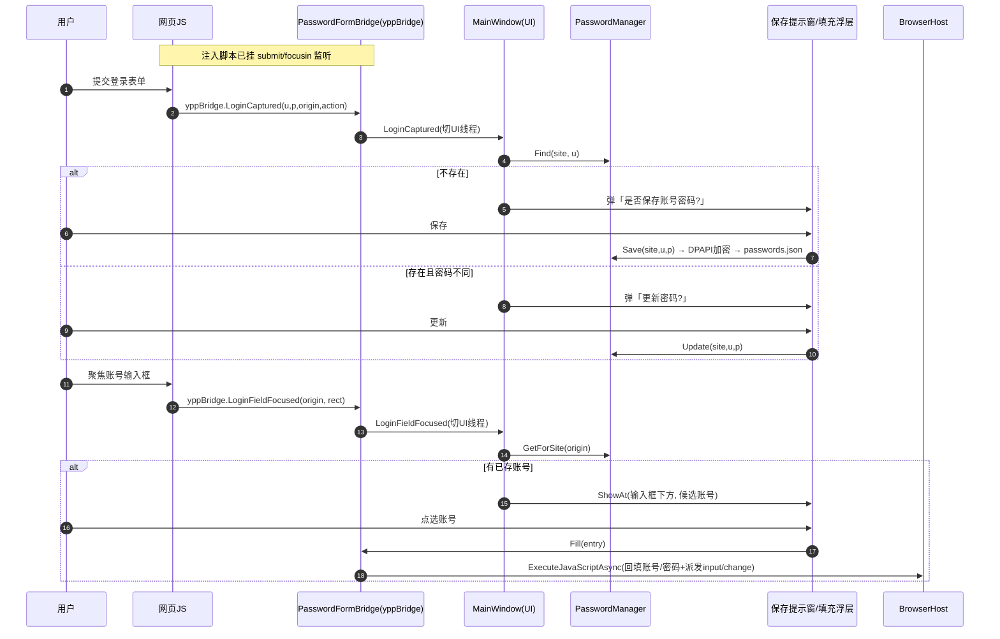
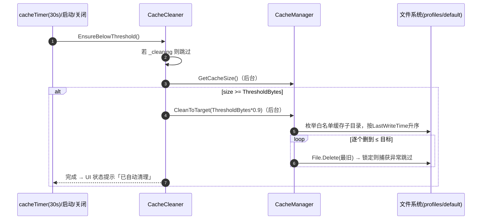
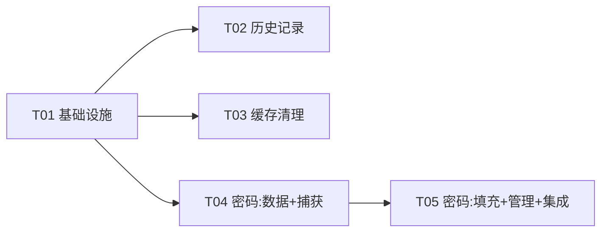

# 「页游++」三个新功能系统设计文档（历史记录 / 密码管理器 / 缓存自动清理）

> 版本：v1.0（设计稿）
> 作者：software-architect（高见远）
> 需求依据：产品 PRD + 主理人已拍板决策
> 范围：仅设计，不写实现代码、不改动现有源文件
> 技术基线：C# net462（x64，WPF + WinForms），CefSharp.WinForms 84.4.10 / Chromium 84，唯一数据持久化依赖 Newtonsoft.Json 13.0.3，零额外 native 依赖

---

## 0. 结论速览（TL;DR）

| 决策点 | 结论 |
|--------|------|
| (1) 历史记录存储 | **自捕获**（CefSharp 84 无公开历史查询 API）；JSON 单文件 `history.json`（与 Favorites/QuickLinks 同模式）；按 URL 合并 + 90 天保留 + 条数上限兜底 |
| (2) 密码管理器 | **完全自实现**（CEF 84 无原生密码保存/自动填充）；JS 注入捕获登录表单 → WPF 弹窗提示 → DPAPI 加密落盘 → 「点击后填充」用 `ExecuteJavaScriptAsync` 回填 |
| (3) 缓存清理 | **文件系统逐删 + 跳过锁定**（CefSharp 84 无 `ClearCache`/`ClearCacheAsync`）；白名单缓存子目录按 `LastWriteTime` 最旧优先，清到阈值 90% 即停；后台线程 + 启动/30s 轮询/关闭各触发一次 |

核心原则：**最正确技术路线优先，但坚决不加 native 依赖**——三个功能全部复用项目现有 JSON 持久化模式 + net462 自带 DPAPI + CefSharp 84 现有的 JS 桥接/注入能力，**新增 NuGet 数量为 0**。

---

## 1. 实现方案与关键选型

### 1.1 选型 ①：历史记录的存储与捕获

**结论：CefSharp 84 没有现成历史 API，必须自己捕获；存储用 JSON（单文件 `history.json`），不用 SQLite。**

**为什么 CefSharp 84 没有现成 API：**
- CEF 84 的公开接口（`IRequestContext`、`IBrowserHost`、`ICookieManager`）经核实**均不提供**浏览历史（Visit History / `History` DB）的查询或遍历能力。CEF 本身不打包 Chrome 的 History 前端与相关 C++ 查询接口，历史数据虽然以 SQLite 形式存在于 profile 目录内，但**没有托管 API 可读**。
- 因此「浏览历史查看」只能走**自捕获**路线：在应用自己的导航事件里记录。

**捕获点设计：**
- 在 `BrowserHost.AddressChanged`（主框架导航）触发时记录——它已由 `MainWindow.OnTabAddressChanged` 消费，天然是「每次导航都会经过」的单一入口。
- 过滤规则：只记录 `http://` / `https://`，排除 `about:blank`、`javascript:`、内页跳转产生的噪声。
- 标题：记录时取 `tab.Host.Title`；由于 `TitleChanged` 晚于 `AddressChanged`，补充在 `OnTabTitleChanged` 里调用 `HistoryService.UpdateTitle(url, title)` 刷新同 URL 最近一条记录的标题，保证列表展示的标题是「最后知道的标题」。

**存储格式：JSON 单文件（推荐，明确不引入 SQLite）**

| 维度 | JSON（推荐） | SQLite |
|------|--------------|--------|
| 数据量 | 页游浏览器历史量级很小（90 天 + 5000 条合并后上限，几 MB 内） | 明显大材小用 |
| 依赖 | 复用已有 Newtonsoft.Json | System.Data.SQLite 或 SQLitePCLRaw 需带 native DLL |
| 与现有代码一致性 | 与 Favorites / QuickLinks / ShadowManager 完全一致 | 引入新范式 |
| 并发 | 单 UI 线程读写 + 原子 `File.WriteAllText`，无并发问题 | 需要连接管理 |

**合并与淘汰：**
- 以规范化 URL 为键合并：保留 scheme、去除 fragment（`#...`），**保留 query**（页游 URL 常带 session 参数，去 query 会过度合并）。同一 URL 再次访问 → 更新 `LastVisitedUtc` + `Title`。
- 淘汰：`HistoryService` 每次加载与每次写入后执行 `Prune()`——先删 `LastVisitedUtc` 早于 90 天的记录；若仍超过 `MaxItems`（默认 5000），按时间最旧继续淘汰。
- 与缓存清理**完全独立**：历史文件在 `DataDir\history.json`，缓存清理只作用于 `profiles` 下的缓存白名单目录，互不触碰。

---

### 1.2 选型 ②：密码管理器在 CefSharp 84 的可行性

**结论：CEF/CefSharp 84 不提供原生密码保存提示与自动填充，必须自实现。** 自实现是唯一可行且可控的路径，分四块：登录表单捕获、保存提示 UI、点击后填充、DPAPI 加密。

**为什么 CEF 原生密码能力不可用：**
- CEF 的官方构建**不包含** Chrome 的 Password Manager / Autofill 组件（这些是 Chrome 浏览器层能力，非 CEF 内核能力），也没有对应 CefSharp API（无 `PasswordManager`、无 autofill 接口）。
- 因此「保存提示 + 自动填充」只能由应用层实现。好消息是 CefSharp 84 已具备完整原料：`JavascriptObjectRepository.Register`（JS↔C# 双向桥）、`ExecuteJavaScriptAsync`（C#→JS 注入）、以及 net462 自带的 `ProtectedData`（DPAPI）。

**实现路径（四块）：**

**(a) 登录表单检测 + 提交捕获（JS 注入）**
- 新增 `PasswordScripts.cs` 保存注入脚本（字符串常量）。脚本在页面加载完成后由 `BrowserHost` 注入（`LoadingStateChanged` 且 `IsLoading == false` 时 `ExecuteJavaScriptAsync`）。脚本**幂等**：先 `await CefSharp.BindObjectAsync('yppBridge')`（异步绑定），再用事件委托在 `document` 捕获阶段监听 `submit`，避免反复注入导致重复挂监听。
- 提交时启发式提取字段：
  1. 密码字段：表单内第一个非空 `input[type=password]`；
  2. 用户名字段：按优先级——`input[type=email]` → `input[name/autocomplete 匹配 user|login|account|phone|mail|id]` → password 字段之前最近的 `input[type=text]`。
- 提取成功后调用 `yppBridge.loginCaptured(username, password, origin, actionUrl)`。

**(b) 保存提示 UI**
- `PasswordFormBridge` 在 CEF 回调线程收到调用，`Dispatcher.InvokeAsync` 切回 UI 线程后触发 `MainWindow` 订阅的事件。
- `MainWindow` 调 `PasswordManager.Find(site, username)` 判重：
  - 不存在 → 弹 `PasswordSavePromptWindow`（保存 / 不保存）；
  - 存在且密码不同 → 弹「更新密码」确认（更新 / 保持）；
  - 存在且相同 → 静默跳过（或仅刷新 `UpdatedUtc`）。
- 提示窗为 `Owner = MainWindow` 的普通 WPF 模态窗——它是独立顶层窗口，不受 CEF HwndHost 的 AirSpace 遮挡。

**(c) 点击后填充（不自动提交）**
- 注入脚本同时监听输入框 `focusin`：当焦点落在「用户名/密码输入框」时，调用 `yppBridge.loginFieldFocused(origin, rectJson)`，`rectJson` 为 `getBoundingClientRect()` 的 `{x,y,w,h}`。
- `MainWindow` 查询 `PasswordManager.GetForSite(origin)`，有已存账号则弹 `PasswordFillPopup`——一个 `ShowActivated=false`、`Topmost=true` 的无边框小窗，用 `BrowserHost.ViewportToScreen(rect.x, rect.y+rect.h)` 换算屏幕坐标、定位到输入框正下方（AirSpace 下置顶独立窗口是可靠方案）。
- 用户点选账号 → `PasswordFormBridge.Fill(entry)` → `ExecuteJavaScriptAsync` 把账号/密码写回对应输入框并派发 `input`/`change` 事件（让页游前端框架感知到值变化），**不自动提交**。

**(d) DPAPI 加密存储**
- 新增 `DpapiProtector.cs`：`ProtectedData.Protect(byte[], null, DataProtectionScope.CurrentUser)` → Base64；解密 `Unprotect`。明文只在内存短暂存在（填充/查看用），落盘只有 Base64 密文，无需主密码。
- 存储 `passwords.json`（DataDir），条目：`Site`（规范化 host，小写）、`Username`（明文，便于列表展示/搜索）、`PasswordEncrypted`（Base64）、`Url`（可选）、`CreatedUtc`、`UpdatedUtc`。唯一键 = `Site + Username`（trim）。

**桥接对象注册（关键时序）：**
- `BrowserHost` 在构造函数中、`CreateControl()` **之前**执行 `browser.JavascriptObjectRepository.Register("yppBridge", bridge, isAsync: true)`，否则 handler 挂载时序会出问题（与现有注释里「必须在 CreateControl 前挂 handler」同理）。
- 每个标签页一个 `PasswordFormBridge` 实例（绑定本标签 `BrowserHost`），保证填充写回正确标签。

---

### 1.3 选型 ③：缓存清理的正确方式

**结论：CefSharp 84 没有 `ClearCache` / `ClearCacheAsync` / `ClearDataForOrigin`，只能「文件系统逐删 + 跳过锁定」。**

**核实结果：**
- 已核对 CefSharp `v84.4.10` 的 `IRequestContext` 源码：只有 `CachePath` 属性、`ClearCertificateExceptions`、`ClearHttpAuthCredentials`、`PurgePluginListCache` 等，**没有** `ClearCache` / `ClearCacheAsync`。（`ClearCacheAsync` 是较新 CefSharp 才加入的 API，84 没有。）
- 原生 CEF 84 也未公开 HTTP 缓存清除接口。因此「真实生效的清理」只能走文件系统。

**方案：白名单缓存子目录 + 最旧优先流式删除**

- **可删范围（白名单）**：`Cache`、`Code Cache`、`GPUCache`、`ShaderCache`、`GrShaderCache`、`DawnGraphiteCache`、`DawnWebGPUCache`——与 `DataBackup.SkipDirectories` 的缓存目录清单对齐。
- **绝不触碰**：`Cookies`、`Local Storage`、`IndexedDB`、`Network`（部分）等承载登录态与游戏存档的目录，以及 `DataDir` 下的历史/密码/收藏文件。这样清理缓存不会把用户登出、不会丢存档。
- **`GetCacheSize()`**：只统计上述白名单子目录内的文件大小（与清理范围一致，避免「测全 profile、清局部」导致永远到不了 90% 目标）。
- **`CleanToTarget(targetBytes)`**：
  1. 枚举白名单子目录下所有文件，`FileInfo` 读 `LastWriteTimeUtc` + `Length`；
  2. 按 `LastWriteTimeUtc` 升序（最旧优先）；
  3. 逐个 `File.Delete`，`IOException` / `UnauthorizedAccessException`（CEF 锁定）捕获后跳过；
  4. 累计剩余大小 ≤ `targetBytes` 即停（或无可删文件时停止）；
  5. 最后对已清空的缓存子目录尝试删除空目录（可选、忽略失败）。
  - 全程 `Task.Run` 后台线程，不卡 UI。
- **「清到 90% 即停」**：`CacheCleaner.EnsureBelowThreshold()` 中，当 `GetCacheSize() ≥ ThresholdBytes` 时，目标 = `(long)(ThresholdBytes * 0.9)`，留 10% 余量避免「删完马上又长回来、频繁触发」。
- **阈值设置**：`AppSettings.CacheCleanThresholdMB`（int，默认 800，下限 100）。`CacheCleaner.ThresholdBytes = clamp(阈值, 100MB, int.Max) * 1MB`。现有 `CacheWarningBytes`/`CacheDangerBytes` 常量改为从设置读取。
- **触发点**：复用现有 `cacheTimer`（30s 轮询）+ 启动立即查一次（现有 `CacheTimer_Tick` 已在构造时调用）+ 关闭时查一次（`OnClosed`）。`_cleaning` 标志防重入。
- **手动「清理缓存」按钮**：保留现有「删 cookies + 清缓存」语义，但底层改为调用新 `CleanToTarget(0)` 的逐删实现（真正生效），修复 `Directory.Delete(CacheDir, true)` 删不动的 bug。

---

## 2. 文件列表（相对路径）

### 2.1 新增文件

| 相对路径 | 职责 |
|----------|------|
| `cs/src/DpapiProtector.cs` | DPAPI 加密/解密/掩码（密码功能的基础设施） |
| `cs/src/HistoryService.cs` | 历史记录数据模型 + 捕获/合并/检索/淘汰/持久化 |
| `cs/src/HistoryWindow.xaml` | 历史记录视图（弹窗）：搜索框 + 倒序列表 + 单删 + 清空 |
| `cs/src/HistoryWindow.xaml.cs` | 历史窗口逻辑 |
| `cs/src/PasswordManager.cs` | 密码条目数据模型 + CRUD + DPAPI 加密持久化 |
| `cs/src/PasswordScripts.cs` | 注入 JS（登录捕获 + 焦点上报）与填充 JS 生成器 |
| `cs/src/PasswordFormBridge.cs` | 每标签页的 JS 桥接对象（`yppBridge`） |
| `cs/src/PasswordSavePromptWindow.xaml` | 保存/更新密码提示窗 |
| `cs/src/PasswordSavePromptWindow.xaml.cs` | 提示窗逻辑 |
| `cs/src/PasswordFillPopup.xaml` | 点击后填充的候选账号浮层（无边框置顶小窗） |
| `cs/src/PasswordFillPopup.xaml.cs` | 填充浮层逻辑 |
| `cs/src/PasswordManagerWindow.xaml` | 设置内的密码管理页（站点/账号/掩码 + 查看/编辑/删除） |
| `cs/src/PasswordManagerWindow.xaml.cs` | 密码管理页逻辑 |
| `cs/src/CacheCleaner.cs` | 缓存自动清理调度（阈值 + 后台触发 + 防重入） |

### 2.2 修改文件

| 相对路径 | 修改点 |
|----------|--------|
| `cs/src/YeyouPlusPlus.csproj` | 新增 `<Reference Include="System.Security" />`（DPAPI 所在程序集） |
| `cs/src/AppSettings.cs` | 新增 `int CacheCleanThresholdMB`（默认 800） |
| `cs/src/AppPaths.cs` | 新增 `HistoryFilePath`、`PasswordsFilePath` 便捷属性 |
| `cs/src/BrowserHost.cs` | 注册 `yppBridge`、加载完成时注入密码脚本、新增 `ViewportToScreen` / `ExecuteJavaScriptAsync` 便捷方法、新增 `LoginCaptured` / `LoginFieldFocused` 事件与 `FillPassword` |
| `cs/src/CacheManager.cs` | 新增 `GetCacheSize`、`CleanToTarget`、`CacheSubDirNames`；`ClearCache` 改为逐删实现 |
| `cs/src/MainWindow.xaml` | 侧边栏加「历史记录」入口按钮；设置页加「缓存自动清理阈值」输入 + 「密码管理」入口 |
| `cs/src/MainWindow.xaml.cs` | 历史记录接线（记录/更新标题/打开窗口）；密码提示/填充浮层/管理页接线；缓存清理接线（阈值读取/启动/关闭触发/状态提示）；`ChangeDataDir` 迁移清单补 `history.json`、`passwords.json` |

> 说明：`DataBackup.cs` 已整目录备份（并跳过缓存目录），无需改动即可覆盖新数据文件。

---

## 3. 数据结构与接口

### 3.1 类图（Mermaid）

```mermaid
classDiagram
    direction TB

    %% ================= 历史记录 =================
    class HistoryItem {
        +string Url
        +string Title
        +DateTime LastVisitedUtc
    }
    class HistoryService {
        -List~HistoryItem~ _items
        +const int RetentionDays = 90
        +const int MaxItems = 5000
        +IReadOnlyList~HistoryItem~ Items$
        +Record(string url, string title)$
        +UpdateTitle(string url, string title)$
        +Remove(string url)$
        +Clear()$
        +Search(string keyword) List~HistoryItem~$
        +Reload()$
        -NormalizeUrl(string url) string$
        -Prune() void
        -Load() List~HistoryItem~$
        -Save() void
    }
    class HistoryWindow {
        +event Action~string~ NavigateRequested
        -ApplyFilter() void
        -DeleteSelected() void
        -ClearAll() void
    }

    %% ================= 密码管理 =================
    class DpapiProtector {
        +Protect(string plain) string$
        +Unprotect(string base64) string$
        +Mask(string plain) string$
    }
    class PasswordEntry {
        +string Site
        +string Username
        +string PasswordEncrypted
        +string Url
        +string CreatedUtc
        +string UpdatedUtc
    }
    class PasswordManager {
        -List~PasswordEntry~ _items
        +IReadOnlyList~PasswordEntry~ Items$
        +GetForSite(string hostOrUrl) List~PasswordEntry~$
        +Find(string site, string username) PasswordEntry$
        +Save(string site, string username, string password, string url) bool$
        +Update(string site, string oldUsername, string username, string password) bool$
        +Delete(string site, string username) void$
        +Decrypt(string passwordEncrypted) string$
        +Reload()$
        -NormalizeHost(string hostOrUrl) string$
        -Load() List~PasswordEntry~$
        -Save() void
    }
    class PasswordScripts {
        +string Inject$
        +BuildFillScript(string username, string password) string$
    }
    class PasswordFormBridge {
        -BrowserHost _host
        +void LoginCaptured(string username, string password, string origin, string actionUrl)
        +void LoginFieldFocused(string origin, string rectJson)
        +void Fill(PasswordEntry entry)
    }
    class PasswordSavePromptWindow {
        +bool ShouldSave
        +string Message
    }
    class PasswordFillPopup {
        +event Action~PasswordEntry~ EntrySelected
        +void ShowAt(double screenX, double screenY, IReadOnlyList~PasswordEntry~ entries)
    }
    class PasswordManagerWindow {
        -void ShowPassword(PasswordEntry entry)
        -void Edit(PasswordEntry entry)
        -void Delete(PasswordEntry entry)
    }

    %% ================= 缓存清理 =================
    class CacheManager {
        +IReadOnlyList~string~ CacheSubDirNames$
        +GetDirectorySize(string path) long$
        +GetCacheSize() long$
        +CleanToTarget(long targetBytes, Action onCompleted)$
        +ClearCache(Action onCompleted)$
    }
    class CacheCleaner {
        -bool _cleaning
        +long ThresholdBytes$
        +bool IsCleaning$
        +void EnsureBelowThreshold()
    }
    class AppSettings {
        +int CacheCleanThresholdMB
    }

    %% ================= 关系 =================
    HistoryService --> HistoryItem : "包含"
    HistoryWindow --> HistoryService : "查询/删除"
    PasswordManager --> PasswordEntry : "包含"
    PasswordManager --> DpapiProtector : "加密/解密"
    PasswordFormBridge --> PasswordManager : "查重/保存"
    PasswordFormBridge --> PasswordScripts : "注入/填充"
    PasswordFormBridge --> BrowserHost : "回填 JS"
    PasswordManagerWindow --> PasswordManager : "查看/编辑/删除"
    PasswordFillPopup --> PasswordManager : "候选数据"
    CacheCleaner --> CacheManager : "测大小/清理"
    CacheCleaner --> AppSettings : "阈值来源"
```



### 3.2 关键接口说明（文字版）

**`HistoryService`（静态）**
- `Record(string url, string title)`：规范化 URL（去 fragment），合并到已有条目（更新 `LastVisitedUtc`/`Title`）或新插入，随后 `Prune()` + `Save()`。
- `Search(string keyword)`：对 `Url` + `Title` 做忽略大小写的包含匹配，返回倒序列表。
- `Prune()`：删除超过 90 天的；超 `MaxItems` 再按时间最旧淘汰。

**`PasswordManager`（静态）**
- `Save(site, username, password, url)`：密码经 `DpapiProtector.Protect` 加密后写入；`site` 用 `NormalizeHost`（`new Uri().Host`，小写）。
- `Decrypt(encrypted)`：`DpapiProtector.Unprotect`。
- 唯一键 `Site + Username`（username 保留大小写但 trim）。

**`PasswordFormBridge`（每标签页实例，暴露给 JS 名为 `yppBridge`）**
- `LoginCaptured` / `LoginFieldFocused`：JS 可调用；内部 `Dispatcher.InvokeAsync` 切回 UI 线程后回调 `BrowserHost` 事件。
- `Fill(entry)`：`PasswordScripts.BuildFillScript` 生成 JS，经 `BrowserHost` 注入回填。

**`CacheManager`（静态，扩展）**
- `GetCacheSize()`：白名单缓存子目录内文件大小之和。
- `CleanToTarget(long targetBytes, Action onCompleted)`：最旧优先逐删到目标；后台线程执行；完成回调切回调用线程（沿用现有 `ContinueWith(..., TaskScheduler.FromCurrentSynchronizationContext())` 惯例）。

**`CacheCleaner`（静态）**
- `ThresholdBytes`：读 `AppSettings.CacheCleanThresholdMB`，clamp 下限 100MB。
- `EnsureBelowThreshold()`：`_cleaning` 防重入；超阈值则 `CleanToTarget(ThresholdBytes * 0.9)`。

---

## 4. 调用流程

### 4.1 历史记录：捕获 + 查看



### 4.2 密码：登录捕获 → 保存 → 点击填充



### 4.3 缓存自动清理



---

## 5. 任务列表（有序，供工程师逐项实现）

> 硬约束：≤5 个任务；每个任务 ≥3 个文件；第一任务是基础设施；除 T05 依赖 T04 外，其余尽量只依赖 T01。

### T01 基础设施与共享数据层（P0）
- **内容**：新增 `System.Security` 程序集引用（DPAPI）；`AppSettings` 加 `CacheCleanThresholdMB`；`AppPaths` 加 `HistoryFilePath`/`PasswordsFilePath`；新增 `DpapiProtector.cs`。
- **源文件**：`YeyouPlusPlus.csproj`、`AppSettings.cs`、`AppPaths.cs`、`DpapiProtector.cs`
- **依赖**：无
- **验收**：项目编译通过；`DpapiProtector.Protect/Unprotect` 往返一致；设置项可序列化。

### T02 历史记录功能（P0）
- **内容**：`HistoryService`（捕获/合并/检索/淘汰/持久化）；`HistoryWindow`（搜索 + 倒序列表 + 单删 + 清空二次确认）；`MainWindow` 接线（`OnTabAddressChanged` 记录、`OnTabTitleChanged` 更新标题、侧边栏「历史记录」按钮、`ChangeDataDir` 迁移清单补 `history.json`）。
- **源文件**：`HistoryService.cs`、`HistoryWindow.xaml`、`HistoryWindow.xaml.cs`、`MainWindow.xaml`、`MainWindow.xaml.cs`
- **依赖**：T01（`AppPaths.HistoryFilePath`）

### T03 缓存自动清理（修复 + 增强）（P0）
- **内容**：`CacheManager` 加 `CacheSubDirNames`/`GetCacheSize`/`CleanToTarget` 并修复 `ClearCache`；新增 `CacheCleaner`；`MainWindow` 接线（阈值读取/设置项 UI/启动+关闭触发/替换 `HandleCacheSize` 逻辑/状态提示）。
- **源文件**：`CacheManager.cs`、`CacheCleaner.cs`、`MainWindow.xaml`、`MainWindow.xaml.cs`
- **依赖**：T01（`AppSettings.CacheCleanThresholdMB`）

### T04 密码管理器：数据层 + 捕获 + 保存提示（P0）
- **内容**：`PasswordManager`（模型 + CRUD + DPAPI 加密落盘）；`PasswordScripts`（注入/填充 JS）；`PasswordFormBridge`（`yppBridge`）；`PasswordSavePromptWindow`；`BrowserHost` 改造（注册桥接、注入脚本、`ViewportToScreen`、事件与 `FillPassword`）。
- **源文件**：`PasswordManager.cs`、`PasswordScripts.cs`、`PasswordFormBridge.cs`、`PasswordSavePromptWindow.xaml`、`PasswordSavePromptWindow.xaml.cs`、`BrowserHost.cs`
- **依赖**：T01（`DpapiProtector`）

### T05 密码管理器：填充浮层 + 管理页 + 集成联调（P0）
- **内容**：`PasswordFillPopup`（点击后填充候选浮层）；`PasswordManagerWindow`（设置内列表：查看/编辑/删除）；`MainWindow` 集成（订阅 `LoginCaptured`/`LoginFieldFocused`、打开提示窗/浮层/管理页、设置页入口、`ChangeDataDir` 迁移清单补 `passwords.json`）；整体联调。
- **源文件**：`PasswordFillPopup.xaml`、`PasswordFillPopup.xaml.cs`、`PasswordManagerWindow.xaml`、`PasswordManagerWindow.xaml.cs`、`MainWindow.xaml`、`MainWindow.xaml.cs`
- **依赖**：T04

### 任务依赖图



---

## 6. 依赖包

```
- 新增 NuGet 包：无（CefSharp.WinForms 84.4.10、Newtonsoft.Json 13.0.3 均已具备）
- 新增程序集引用：System.Security（net462 自带，DPAPI ProtectedData 所在，SDK 风格工程需显式 <Reference>）
- 新增 native 依赖：无（明确不引入 SQLite / SQLitePCLRaw / System.Data.SQLite）
```

---

## 7. 共享知识（跨文件约定）

- **数据文件**：统一放 `AppPaths.DataDir`，内存列表 + `JsonConvert.SerializeObject(..., Formatting.Indented)` 原子写盘；`Reload()` 支持数据目录迁移（对齐 Favorites/QuickLinks/ShadowManager）。
- **时间**：历史记录用 `DateTime.UtcNow`（JSON 默认 ISO8601）；密码条目 `CreatedUtc/UpdatedUtc` 用 `DateTime.UtcNow.ToString("yyyy-MM-dd HH:mm:ss")`。
- **URL 规范化**：host 用 `new Uri(raw).Host.Trim().ToLowerInvariant()`（`NormalizeHost`）；历史完整 URL 去 fragment、保留 scheme/query；密码/缩放/影子按 host。
- **线程**：CEF 回调线程 ≠ UI 线程，跨线程到 UI 一律 `Dispatcher.InvokeAsync`；后台长任务 `Task.Run` + `ContinueWith(..., TaskScheduler.FromCurrentSynchronizationContext())` 回 UI（沿用现有惯例）。
- **DPAPI**：`DataProtectionScope.CurrentUser`、entropy 传 null；明文只在内存，落盘仅 Base64(密文)。
- **缓存清理边界**：只遍历白名单缓存子目录（`Cache`/`Code Cache`/`GPUCache`/`ShaderCache`/`GrShaderCache`/`DawnGraphiteCache`/`DawnWebGPUCache`），**绝不删** `Cookies`/`Local Storage`/`IndexedDB` 及 DataDir 数据文件。
- **JS 注入**：注入脚本必须幂等（先 `BindObjectAsync` 判重，再挂监听，防重复注入）。
- **迁移清单**：新增 `history.json`、`passwords.json` 到 `MainWindow.ChangeDataDirButton_Click` 的文件迁移数组。
- **桥接注册时序**：`yppBridge` 必须在 `BrowserHost` 构造内、`CreateControl()` 之前 `Register(..., isAsync: true)`。

---

## 8. 待明确事项（需主理人/用户确认）

1. **手动「清理缓存」是否保留删 cookies？** 现有按钮会 `DeleteCookies`（会退出所有页游登录态）。建议：保留但加二次确认，或改为「仅清缓存、保留登录」。需产品拍板。
2. **历史记录是否包含「影子」标签？** 影子是独立 RequestContext 的隔离浏览，建议纳入历史（统一体验），但若强调隔离语义可排除。需确认。
3. **密码填充候选框形态与是否自动提交：** 本设计为「无边框置顶小窗、点击后仅填充不提交」。若产品希望更贴近 Chrome 的原生下拉形态，实现复杂度更高（AirSpace 下坐标定位需更精细），需确认接受当前简化形态。
4. **DPAPI 是否加固定 entropy：** 加 entropy 可防「同用户的其他进程直接解密」，但换用户/换机不可迁移；不加则与当前「本地无主密码」目标更一致。默认不加。
5. **历史「合并」是否忽略 query 参数：** 本设计保留 query（避免页游 session 参数导致过度合并）。若希望「同页面不同参数也合并」，可改为去 query，需确认。
